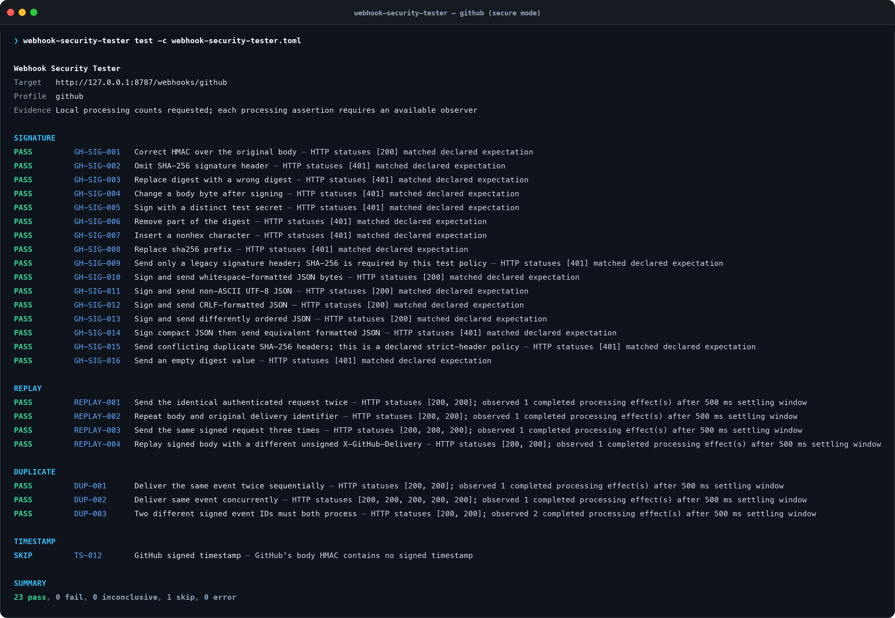
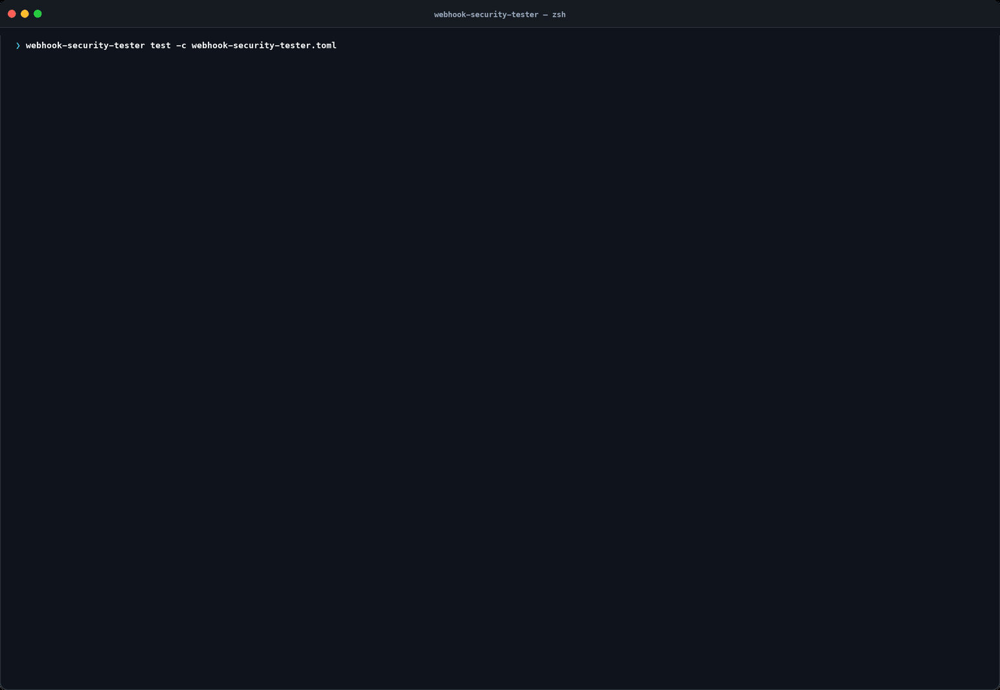
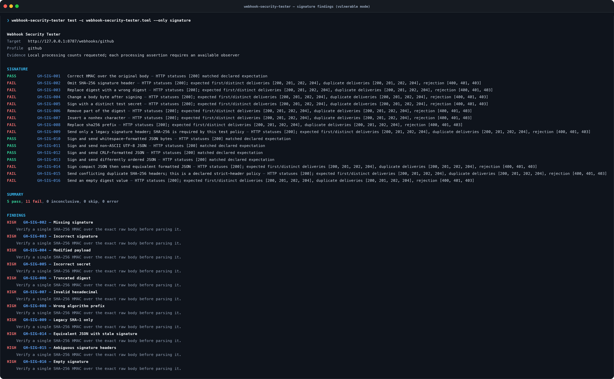
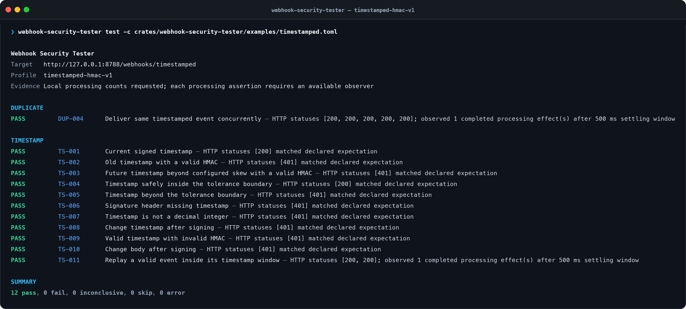
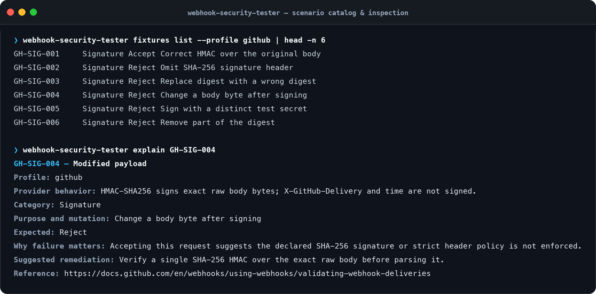

# Webhook Security Tester

**Prove your webhook handler behaves securely before production.**

Webhook Security Tester sends controlled, signed, and intentionally mutated HTTP deliveries to local webhook endpoints. It verifies signature validation, catches payload manipulation, exercises replay and concurrency deduplication, and—when an observer endpoint is enabled—measures whether side effects were executed exactly once. The target handler can be implemented in any language or framework.



---

## The Problem It Solves

Webhook receivers are frequently vulnerable to subtle security defects:

1. **Re-serialized verification**: Verifying signatures over parsed/re-serialized JSON rather than exact incoming raw bytes, allowing payload mutation attacks.
2. **Replay vulnerability**: Accepting identical signed payloads multiple times because handlers rely only on HTTP status codes rather than atomic deduplication.
3. **Header trust**: Relying on unsigned transport headers (such as GitHub's `X-GitHub-Delivery`) as idempotency keys, which an attacker can change while keeping the signature valid.
4. **Clock skew and replay in window**: In timestamped protocols, failing to enforce clock tolerance boundaries or accepting replays within the validity window.
5. **False confidence from HTTP 200**: Returning HTTP 200 upon receiving a delivery does not prove whether background processing was executed once, duplicated, or silently dropped.

Webhook Security Tester runs reproducible conformance scenarios against loopback endpoints to verify both transport-level HTTP responses and actual backend processing effects.

---

## Visual Demonstrations

### Live Conformance Test Run

An animated session demonstrating suite execution, sequential delivery, concurrent barrier testing, and observer settling:



### Showcase Gallery

| Scenario                                                                                                                                                   | Demonstration                                                                                                          |
| ---------------------------------------------------------------------------------------------------------------------------------------------------------- | ---------------------------------------------------------------------------------------------------------------------- |
| **Vulnerability Detection**<br>Running against an insecure handler (`--mode no-signature`) flags high-severity findings with actionable remediation steps. | [](docs/screenshots/vulnerability-findings.png) |
| **Timestamped Protocols**<br>Verifying synthetic `timestamped-hmac-v1` clock tolerance boundaries, skew rejection, and in-window duplicate suppression.    | [](docs/screenshots/timestamped-profile.png)             |
| **Catalog & Offline Inspection**<br>Listing built-in scenarios (`fixtures list`) and querying security significance and remediation (`explain <ID>`).      | [](docs/screenshots/explain-and-fixtures.png)           |

---

## Key Features

- **GitHub Signature Protocol**: Full coverage of `X-Hub-Signature-256` raw-body HMAC verification, including missing headers, corrupted digests, wrong secrets, whitespace formatting, Unicode characters, CRLF variations, and strict ambiguous-header rejection.
- **Timestamped HMAC Protocol**: Synthetic `timestamped-hmac-v1` testing covering valid timestamps, tolerance boundaries, future clock skew, malformed decimal values, and in-window replay attacks.
- **Replay & Idempotency Testing**: Exact duplicates, triple replays, unsigned delivery header tampering (`X-GitHub-Delivery`), sequential delivery, and barrier-synchronized concurrent delivery.
- **Observer Verification Contract**: Connects to loopback observer endpoints (`POST /__webhookproof/reset`, `GET /__webhookproof/observations`) to measure exact processing counts after a configurable settling window.
- **Zero External Dependencies**: Requires no cloud accounts, Docker containers, public tunnels, databases, or third-party tokens. Tests run entirely on loopback (`127.0.0.1`).
- **Comprehensive Reporting**: Emits colored terminal output, versioned JSON artifacts (`report.json`), and GitHub-flavored Markdown reports (`report.md`).
- **Bundled Reference Receiver**: High-performance Axum receiver providing both a secure reference implementation and deliberate vulnerability fixtures for testing.

---

## Installation

### Prerequisites

- Rust stable toolchain (1.80+)
- `cargo` package manager

### From Source

```sh
git clone https://github.com/ranajahanzaib/webhook-security-tester.git
cd webhook-security-tester
cargo build --release
```

The compiled binaries will be available at:

- `target/release/webhook-security-tester` (CLI test runner)
- `target/release/webhook-security-tester-reference-receiver` (Test fixture receiver)

To install globally to your Cargo binary path:

```sh
cargo install --path crates/webhook-security-tester
```

---

## Quick Start

### 1. Initialize Configuration

Generate a starter configuration file:

```sh
webhook-security-tester init -o webhook-security-tester.toml
```

Set the signing secret in your environment:

```sh
export WEBHOOK_SECURITY_TESTER_GITHUB_SECRET="local-test-secret"
```

### 2. Start the Receiver

In one terminal, launch the reference receiver in secure mode:

```sh
webhook-security-tester-reference-receiver --profile github --port 8787 --mode secure
```

### 3. Run the Conformance Suite

In another terminal, execute the test suite:

```sh
webhook-security-tester test -c webhook-security-tester.toml --json report.json --markdown report.md
```

You will see the test suite execute 23 conformance checks across Signature, Replay, and Duplicate categories:

```text
SIGNATURE
PASS         GH-SIG-001   Correct HMAC over the original body — HTTP statuses [200] matched declared expectation
...
REPLAY
PASS         REPLAY-004   Replay signed body with a different unsigned X-GitHub-Delivery — HTTP statuses [200, 200]; observed 1 completed processing effect(s) after 500 ms settling window
...
SUMMARY
23 pass, 0 fail, 0 inconclusive, 1 skip, 0 error
```

---

## Configuration

Configurations are declared in standard TOML. Example [`webhook-security-tester.toml`](crates/webhook-security-tester/examples/webhook-security-tester.toml):

```toml
version = 1
profile = "github"
endpoint = "http://127.0.0.1:8787/webhooks/github"
secret_env = "WEBHOOK_SECURITY_TESTER_GITHUB_SECRET"
timeout_ms = 3000

[expectations]
accept_statuses = [200, 201, 202, 204]
reject_statuses = [400, 401, 403]
duplicate_statuses = [200, 201, 202, 204]
require_unambiguous_signature_header = true

[runner]
max_body_bytes = 65536
concurrency = 5
follow_redirects = false

[observer]
enabled = true
require = true
settle_ms = 500
```

### Configuration Reference

| Section          | Key                                    | Type    | Description                                                                |
| ---------------- | -------------------------------------- | ------- | -------------------------------------------------------------------------- |
| Root             | `version`                              | Integer | Configuration schema version (must be `1`).                                |
| Root             | `profile`                              | String  | Protocol profile (`github` or `timestamped-hmac-v1`).                      |
| Root             | `endpoint`                             | String  | Loopback URL (`127.0.0.1`, `[::1]`, or `localhost`).                       |
| Root             | `secret_env`                           | String  | Environment variable name holding the shared secret.                       |
| Root             | `timeout_ms`                           | Integer | HTTP request timeout in milliseconds (100–30,000).                         |
| `[expectations]` | `accept_statuses`                      | Array   | Allowed HTTP codes for valid deliveries (default: `[200, 201, 202, 204]`). |
| `[expectations]` | `reject_statuses`                      | Array   | Allowed HTTP codes for rejected deliveries (default: `[400, 401, 403]`).   |
| `[expectations]` | `duplicate_statuses`                   | Array   | Allowed HTTP codes for duplicates (supports 2xx or `409`).                 |
| `[expectations]` | `require_unambiguous_signature_header` | Boolean | Enforce strict rejection when duplicate headers are received.              |
| `[runner]`       | `max_body_bytes`                       | Integer | Maximum accepted response payload size (1,024–1,048,576).                  |
| `[runner]`       | `concurrency`                          | Integer | Parallel requests during concurrent delivery tests (1–32).                 |
| `[observer]`     | `enabled`                              | Boolean | Whether to query observer endpoints for processing evidence.               |
| `[observer]`     | `require`                              | Boolean | Exit with code 2 if observer evidence is unavailable.                      |
| `[observer]`     | `settle_ms`                            | Integer | Settling window before asserting completed counts (default: `500`).        |
| `[timestamp]`    | `tolerance_seconds`                    | Integer | Timestamp age window in seconds (`timestamped-hmac-v1` only).              |
| `[timestamp]`    | `future_skew_seconds`                  | Integer | Max allowable clock skew in seconds (`timestamped-hmac-v1` only).          |

---

## Practical Usage Examples

### Filter by Category

Run only signature verification checks:

```sh
webhook-security-tester test -c webhook-security-tester.toml --only signature
```

Run replay and duplicate checks together:

```sh
webhook-security-tester test -c webhook-security-tester.toml --only replay --only duplicate
```

### Inspect Built-in Scenarios

List all available scenarios for GitHub:

```sh
webhook-security-tester fixtures list --profile github
```

Explain a specific scenario and view its security remediation:

```sh
webhook-security-tester explain GH-SIG-004
```

Output:

```text
GH-SIG-004 — Modified payload
Profile: github
Provider behavior: HMAC-SHA256 signs exact raw body bytes; X-GitHub-Delivery and time are not signed.
Category: Signature
Purpose and mutation: Change a body byte after signing
Expected: Reject
Why failure matters: Accepting this request suggests the declared SHA-256 signature or strict header policy is not enforced.
Suggested remediation: Verify a single SHA-256 HMAC over the exact raw body before parsing it.
Reference: https://docs.github.com/en/webhooks/using-webhooks/validating-webhook-deliveries
```

### Testing Deliberate Vulnerabilities

To verify that your test pipeline properly detects real vulnerabilities, restart the reference receiver in any of its vulnerable test modes:

```sh
# Receiver accepts unauthenticated payloads
webhook-security-tester-reference-receiver --profile github --port 8787 --mode no-signature

# Receiver validates parsed JSON instead of raw bytes
webhook-security-tester-reference-receiver --profile github --port 8787 --mode reserialized-body

# Receiver does not deduplicate repeat events
webhook-security-tester-reference-receiver --profile github --port 8787 --mode no-dedup

# Receiver mistakenly trusts unsigned X-GitHub-Delivery header
webhook-security-tester-reference-receiver --profile github --port 8787 --mode delivery-id-only

# Receiver ignores timestamp boundaries
webhook-security-tester-reference-receiver --profile timestamped-hmac-v1 --port 8788 --mode no-timestamp
```

---

## Observer Contract

For tests involving `ProcessOnce` or `ProcessTwice`, HTTP responses alone are **inconclusive**. A target application can expose the lightweight observer contract in its test environment:

1. `POST /__webhookproof/reset`
   - Resets internal test event IDs and processing counters.
   - Must return HTTP 2xx (`200 OK` or `204 No Content`).
2. `GET /__webhookproof/observations`
   - Returns a JSON object with completed processing counts:
   ```json
   {
     "completed_processing_count": 1
   }
   ```

When testing third-party handlers without an observer, set `observer.enabled = false`. The CLI will verify HTTP status codes while explicitly marking processing effects as `INCONCLUSIVE`.

---

## CI/CD Integration & Exit Codes

The tool returns standard UNIX exit codes suitable for CI gates:

- `0`: All required tests passed.
- `1`: An assertion failed (e.g., signature bypassed, duplicate processed twice).
- `2`: Execution error, configuration error, or missing required observer evidence.

Example GitHub Actions step:

```yaml
- name: Run Webhook Security Tester
  env:
    WEBHOOK_SECURITY_TESTER_GITHUB_SECRET: ${{ secrets.LOCAL_CI_SECRET }}
  run: |
    target/release/webhook-security-tester test \
      -c webhook-security-tester.toml \
      --json report.json \
      --markdown report.md
```

See [docs/ci-integration.md](docs/ci-integration.md) for full workflows.

---

## Architecture & Security Boundaries

```
┌─────────────────────────────────┐       HTTP Loopback       ┌─────────────────────────────────┐
│     webhook-security-tester     │   ────────────────────►   │         Target Consumer         │
│                                 │                           │   (Node, Go, Python, Rust, ...) │
│  • Generates signed payloads    │   ◄────────────────────   │                                 │
│  • Applies mutation strategies  │      HTTP Statuses        │  • Validates raw-body HMAC      │
│  • Barrier concurrency engine   │                           │  • Atomically deduplicates      │
│  • Settling timer & observation │   Observer Reset / Reads  │  • Exposes test observer routes │
│  • Classifies findings          │   ◄───────────────────►   │    (/__webhookproof/*)          │
└─────────────────────────────────┘                           └─────────────────────────────────┘
```

- **Loopback isolation**: Requests are strictly restricted to HTTP loopback destinations (`127.0.0.1`, `[::1]`, or `localhost`).
- **Proxy and redirect prohibition**: HTTP redirect following and system proxy inheritance are disabled.
- **Bounded execution**: Request timeouts, body size caps (64 KiB default), and response consumption limits (8 KiB max) prevent denial-of-service during local testing.
- **Secret safety**: Shared secrets are read exclusively from environment variables and are redacted from JSON and Markdown reports.

See [docs/architecture.md](docs/architecture.md) and [docs/threat-model.md](docs/threat-model.md).

---

## Development

Run formatting, linting, and the full test suite:

```sh
# Check formatting
cargo fmt --all -- --check

# Run linter
cargo clippy --workspace --all-targets -- -D warnings

# Execute all unit and integration tests
cargo test --workspace

# Build release binaries
cargo build --release
```

Detailed documentation:

- [Provider Profiles](docs/provider-profiles.md)
- [Complete Test Catalog](docs/test-catalog.md)
- [Limitations](docs/limitations.md)
- [Threat Model](docs/threat-model.md)
- [CI Integration Guide](docs/ci-integration.md)

---

## Contributing

Contributions are welcome! Please read [CONTRIBUTING.md](CONTRIBUTING.md) and ensure all checks pass before submitting a pull request.

---

## License & Custom Work

[](mailto:work@withrana.com) [](https://www.linkedin.com/in/workwithrana)
[](https://www.upwork.com/freelancers/~01bbcf6edb91a8df5f)
[](https://contra.com/ranajahanzaib/)

**License:** MIT, see [LICENSE](LICENSE). Free for personal and commercial use.

**Author:** Rana Jahanzaib

**Need this built for your stack?** Email me what you're working on: work@withrana.com
